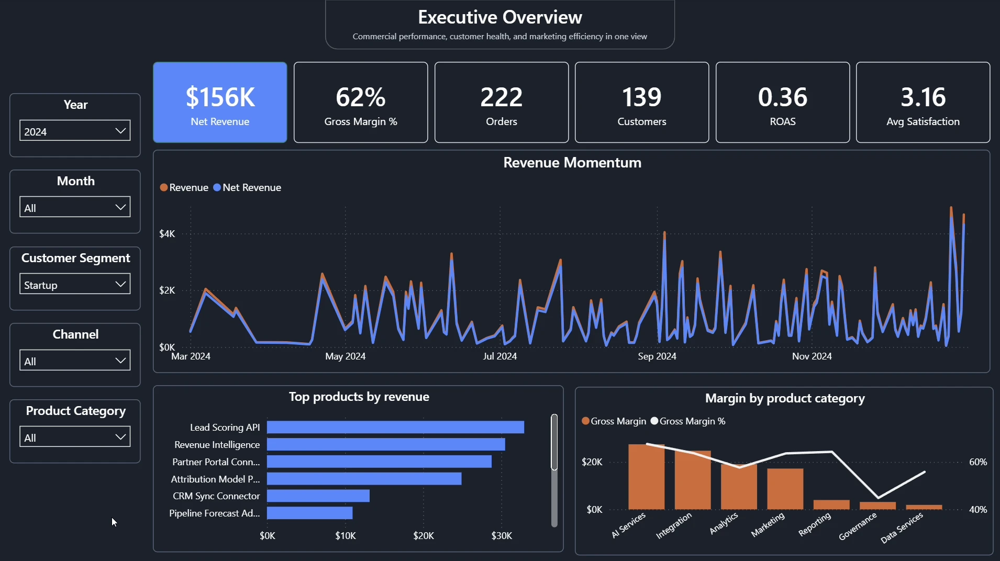

# Sales & Marketing Analytics Platform

A runnable analytics engineering portfolio using synthetic sales, marketing, and support data. A pandas medallion pipeline produces local parquet outputs, and a dbt warehouse builds a tested star schema in DuckDB without cloud credentials. Power BI report and semantic-model source is included; its corrected DAX and Snowflake refresh have not been executed in the current environment.

Built by **Amen Bouallagui** — BI Developer and Analytics Engineer with 2 years of part-time experience in Microsoft Fabric, Power BI, and data migration on real client projects.

> See [docs/real_world_context.md](docs/real_world_context.md) for the professional background this portfolio extends.

---

## Power BI Report



[Watch the Executive Overview demo recording](powerbi/report_screenshots/executive_overview.mp4)

The screenshot (Startup segment selected) and recording predate the KPI corrections. Current measure definitions are in [business metrics](docs/business_metrics.md). The corrected model still needs a working Power BI environment for refresh and visual validation.

Executive Overview page, using Power BI's native Snowflake connector in Import mode — 7 pages total covering revenue, margin, marketing, customer segments, product performance, support quality, and operations/data health. See [powerbi/report_build_guide.md](powerbi/report_build_guide.md) for the full page-by-page breakdown.

---

## Quick Start

Use Python 3.12. Run these commands from the repository root on macOS, Linux, or Windows:

```bash
python -m venv .venv
# macOS / Linux
source .venv/bin/activate
# Windows PowerShell alternative: .venv\Scripts\Activate.ps1
python -m pip install -r requirements.txt
python scripts/run_local_demo.py
```

The demo builds a **fresh DuckDB database**, runs the pandas pipeline, dbt and Python tests, and all eight metric SQL queries. It saves a verification summary, complete metric outputs, and command logs under ignored `outputs/local_demo/`. Choose `--output-dir outputs/another_demo` for another fresh run; existing warehouse files are preserved.

See [verified local results](docs/local_verification.md) for the recorded run, [business case](docs/business_case.md) for purpose and design decisions, and [dbt setup](dbt/README.md) for individual commands.

The pandas pipeline consumes the generated files in `data/source/`. The dbt
warehouse consumes the committed fixtures in `dbt/seeds/`, loaded into `raw`
and `observability` by `dbt seed`. These are separate synthetic datasets;
generating new CSVs does not update the dbt fixtures. See [dbt/README.md](dbt/README.md)
for the source-loading sequence.

---

## What This Demonstrates

### Analytics Engineering
- dbt warehouse on DuckDB: sources → staging → intermediate → marts, with a CI workflow for model and data-test validation
- Dimensional modeling: surrogate keys, conformed dimensions with unknown members, date dimension, 3 fact tables
- dbt tests: uniqueness, not-null, referential integrity, accepted values, and a singular business logic test

### Data Engineering
- Bronze / Silver / Gold medallion pipeline in Python (pandas)
- Bronze: raw records with ingestion metadata, row hashes, source lineage
- Silver: type casting, string normalization, deduplication by business key, data quality flags
- Gold: star schema with KPI-ready measures (net revenue, gross margin, ad conversion rates, support resolution times)
- Observability: pipeline run log, data quality results, row count reconciliation

### Power BI & BI Architecture
- Semantic model authored as code (PBIP / TMDL): 11 data tables plus a measure table, relationships, and 28 DAX measures
- Star schema optimized for Power BI consumption
- Business metric definitions for revenue, margin, marketing, customer, and support KPIs

### Engineering Practices
- GitHub Actions CI: generates data, runs local pipeline, loads dbt seeds before `dbt build` and its data tests, validates `.gitignore` hygiene
- Deterministic synthetic data generator with relational integrity validation
- No credentials or client data committed — all input data is synthetic

---

## Architecture

```
Generated CSVs → pandas Bronze → Silver → Gold parquet outputs
Committed CSV fixtures → dbt seed → staging → intermediate → marts → Power BI (Snowflake Import)
```

The layered analytics design is demonstrated in two implementations with separate inputs:
- **dbt + DuckDB** — committed seed fixtures → staging → intermediate → marts; validated by CI without a cloud account
- **Python / pandas** — generated CSVs → Bronze/Silver/Gold parquet outputs and observability tables

See [docs/architecture.md](docs/architecture.md) and [docs/medallion_design.md](docs/medallion_design.md).

---

## Current Status

| Component | Verification status |
| --- | --- |
| Synthetic generator and pandas medallion pipeline | Executed locally with a fixed seed; regression tests check outputs and key membership |
| dbt warehouse | Fresh DuckDB seed/build and data tests; see the recorded verification |
| SQL metrics | Eight queries executed against the DuckDB warehouse |
| Power BI | Seven report pages and 28 DAX measures present as source; corrected measures and visual rendering unverified |
| Snowflake | Parameterized connection design and portability macros; deployment and refresh unverified |
| Operations page | Uses seeded demonstration telemetry; not current CI or pipeline health |

---

## Repository Areas

| Folder | Contents |
|--------|----------|
| [`dbt/`](dbt/) | dbt + DuckDB warehouse — staging, intermediate, marts, tests, CI |
| [`data_generation/`](data_generation/) | Deterministic synthetic source data generator |
| [`local_pipeline/`](local_pipeline/) | Executable pandas medallion prototype with observability |
| [`powerbi/`](powerbi/) | Semantic model as code (PBIP / TMDL), DAX measures, design notes |
| [`docs/`](docs/) | Architecture, medallion design, data quality, business metrics, roadmap |
| [`sql/`](sql/) | Validation, observability, and business metric queries |
| [`tests/`](tests/) | Pytest test suite |

---

## Data Domain

Six source entities covering the full sales and marketing lifecycle:

| Entity | Key Fields |
|--------|-----------|
| Customers | segment, signup date, status, region |
| Products | catalog, unit price, unit cost, subscription flag |
| Campaigns | channel, start/end dates, budget targets |
| Orders | quantity, discount, tax, net revenue, payment status, refund flag |
| Ad Spend | daily spend, impressions, clicks, conversions by campaign and channel |
| Support Tickets | priority, category, resolution time, first response time, satisfaction score |

---

## Design References

- [Medallion design (Bronze → Silver → Gold)](docs/medallion_design.md)
- [Data quality and observability](docs/data_quality_observability.md)
- [Business metrics (KPI definitions)](docs/business_metrics.md)
- [Power BI semantic model notes](powerbi/semantic_model_notes.md)
- [Power BI report build guide](powerbi/report_build_guide.md)
- [Project roadmap](docs/project_roadmap.md)
- [Portfolio review checklist](docs/portfolio_review_checklist.md)
- [Real-world professional context](docs/real_world_context.md)
